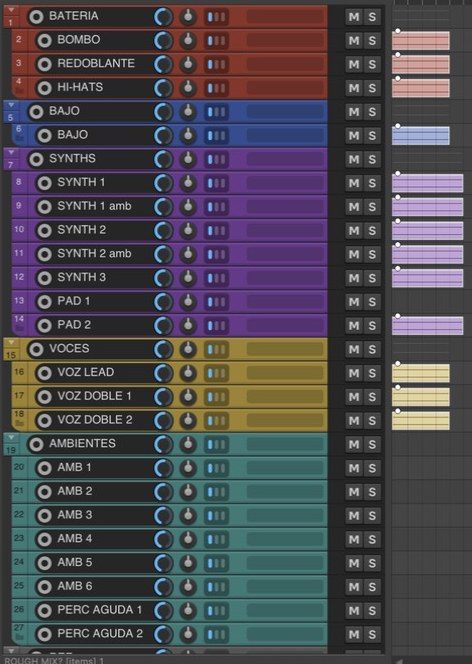

# Panel de IA para REAPER

**Integración de REAPER con Claude Code.** Un chat dentro de REAPER que arma tu sesión, ordena archivos, mide y exporta. Hecho en [Estudio Velador](https://kiyo.ar).

Beta, en desarrollo: probalo sobre una copia de tus sesiones. Lo vamos mejorando con lo que nos cuentes.

> **Velador:** «La IA mide, no escucha. El criterio es tuyo. Esto te saca lo aburrido.»

## 🚀 Paso a paso (REAPER, Mac con chip Apple)

1. 🎚️ **Instalá REAPER** → [reaper.fm/download.php](https://www.reaper.fm/download.php) y abrilo una vez.
2. 🧩 **Instalá ReaImGui** (en REAPER: *Extensions › ReaPack › Browse packages › ReaImGui*) → [descarga](https://github.com/cfillion/reaimgui/releases). Reiniciá REAPER.
3. 💳 **Tené un plan de Claude** (Pro o más) → [claude.com/pricing](https://claude.com/pricing). Lo pagás vos; el uso sale de tu plan.
4. ⌨️ **Instalá Claude Code** → [guía oficial](https://code.claude.com/docs/en/setup). Probá `claude --version`; si es menor a 2.1.280, corré `claude update`.
5. 🍺 **Instalá las piezas** → [Homebrew](https://brew.sh), y en la Terminal: `brew install ffmpeg` y `pip3 install numpy scipy`.
6. ⬇️ **Bajá esto** → [Download ZIP](../../archive/refs/heads/main.zip).
7. ▶️ **Instalá**: en la Terminal, dentro de la carpeta: `sh agent-cable/instalar.sh`.
8. 🪟 **Abrí la ventana**: en REAPER, *Actions › Show action list › New action › Load ReaScript…* → `AgentCable/AgentCable.lua` → ejecutar.
9. 🔑 **Iniciá sesión**: botón *Iniciar sesión*. Se abre la Terminal con el login **oficial de Anthropic**; lo completás ahí.
10. 💬 **Escribí** (ejemplos abajo) y Enter. Cada acción se puede deshacer con **Cmd+Z**.

> **Velador:** «Empezá con una carpeta de audios de prueba, no con la sesión de un cliente.»

## ✍️ Probá pedirle

| | |
|---|---|
| 📁 | «armá una sesión con los audios de /ruta/a/la/carpeta» |
| 🗣️ | «pasale eses a las voces» |
| 📦 | «exportame los stems por familia» |
| 🥁 | «traeme un kick seco y corto de mis samples» |

## 🧰 Qué trae

- 📁 **`cable ordenar`** — copia tus audios ordenados por familia (`BAT 01 - Kick.wav`) y te da una hoja con volumen, balance y fase. Sirve en **cualquier programa**.
  > **Velador:** «Los que tienen `?` los dedujo midiendo: revisalos vos.»
- 📦 **`cable stems`** — stems por familia, sumando los archivos (sin efectos).
- 📊 **`cable medir`** — mide cada audio y te dice cuáles parecen la misma toma.
- 🗣️ **`cable eses`** — de-esser en una copia. El original no se toca.
- 🥁 **`cable samples`** — buscá en tus carpetas de samples (solo lectura): `cable samples agregar "/tu/carpeta"`.
- 🍎 **`cable logic`** — abre los audios en Logic, una pista por archivo. [Más info](docs/logic.md).

Los comandos están en `~/Library/Application Support/REAPER/Scripts/AgentCable/bin/`.

## 📖 Ejemplos reales

Pedidos de verdad, con los tiempos medidos: [docs/ejemplos.md](docs/ejemplos.md).

## 💌 Escribime

Quiero saber qué te pasó, qué te sirvió y qué falta.

- 🐞 **Algo no anda** → [abrir un issue](../../issues/new/choose)
- 💡 **Una idea o un pedido** → [Discusiones](../../discussions)
- 🎚️ **Mostrame cómo lo usaste** → [contame tu ejemplo](../../issues/new?template=ejemplo.yml)
- 📷 **Mensaje directo** → [@kiyo.velador](https://www.instagram.com/kiyo.velador/)

## 🛡️ Cuidado

- Solo puede usar el comando `cable` y leer archivos: no borra, no renombra y no renderiza si no se lo pedís.
- Tus samples se leen, **nunca** se escriben.
- No guarda ni ve tu usuario, contraseña ni código de Claude. [Detalle](SECURITY.md).
- Probado en **REAPER 7 + Mac con chip Apple**. Lo demás, sin probar. Logic: ordena y nombra, sin colores.

## ℹ️ Aviso

Proyecto independiente de Estudio Velador, **no afiliado a Anthropic**. «Claude» y «Claude Code» son marcas de Anthropic. REAPER es de Cockos. Licencia [MIT](LICENSE).

---

<b>Estudio Velador</b> · 🌐 <a href="https://kiyo.ar"><b>kiyo.ar</b></a> · 📷 <a href="https://www.instagram.com/kiyo.velador/">@kiyo.velador</a>

